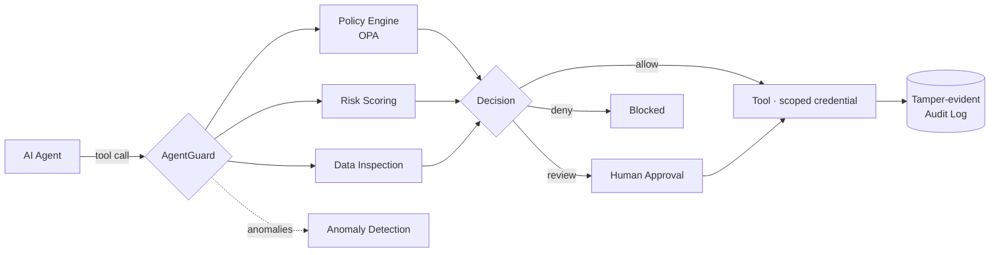
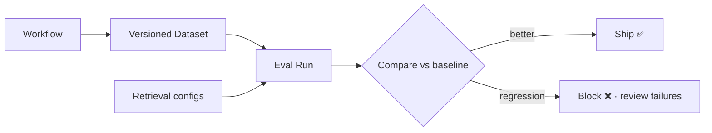

  

  
  
  
  

<table>
<tr>
<td width="52%" valign="top">
⚡ What I do
I engineer AI agents that are safe to give real permissions to — and the backends they run on.
Most agent demos stop at "it called a tool." I work on what comes after: who authorized that call, how risky it was, whether the answer was grounded, and whether the next model version is actually better.
Engineering principles
	
🛡️ Guard the runtime	Policies, scoped credentials and approvals on every tool call
📊 Measure, then ship	Eval suites and release gates before any prompt or model change
🔍 Trace everything	Decisions are logged, auditable and reproducible
⚙️ Boring backends	Typed contracts, clean APIs, Postgres, containers
🎓 B.Tech CSE · SVU College of Engineering  ·  📍 Tirupati, India
</td>
<td width="48%" valign="top">

</td>
</tr>
</table>

🚀 Flagship Systems

  
  
  
  

<b>🔬 Deep dive: AgentGuard architecture</b>

 
Problem: autonomous agents call tools with real credentials, so one bad plan or a prompt injection can leak data or take destructive actions.
Approach: every tool call passes through a deterministic policy layer before it executes, and every decision lands in a tamper-evident log.

<b>🔬 Deep dive: how I evaluate LLM changes</b>

 

Retrieval Lab scores the retrieval layer; LLM Evaluation Lab gates the full workflow. Together, no change ships on vibes.

🧩 Also Built
Project	What it does	Stack	Links
📦 ParcelPilot	Shipment tracking, SLA-aware workflows, AI support agent	Python · FastAPI · React	Live · Code · Agent
🎯 ApplyRight	AI recruitment: resume analysis & application workflows	React · TS · Gemini	Live · Code
🏛️ SevaSetu	Agentic GovTech: citizen questions → evidence-backed action plans · Bharat Agentic 2026	TypeScript · Agents	Code
🏏 Cricket Tournament Manager	Scheduling, live scores, points tables, JWT auth	Java · Spring Boot · MySQL	Live · Code
🏫 Kinder Garden Schools OS	Multi-tenant school management system	JavaScript	Code
📐 LLD Practice Lab	Low-level design patterns, implemented	TypeScript	Code

🧰 Stack

  

  
  
  
  
  
  
  

📡 Live Telemetry

  

  

Recently shipped · refreshed daily by a GitHub Action
<!-- RECENT:START -->
<!-- RECENT:END -->

  <picture>
    <source media="(prefers-color-scheme: dark)" srcset="https://raw.githubusercontent.com/hemanthkumar1012/hemanthkumar1012/output/github-snake-dark.svg"/>
    <source media="(prefers-color-scheme: light)" srcset="https://raw.githubusercontent.com/hemanthkumar1012/hemanthkumar1012/output/github-snake.svg"/>
    
  </picture>

  <b>Building agents that need to be trustworthy? Let's talk.</b>  
  
  

This profile updates itself — stats card, recent activity and snake are regenerated daily by GitHub Actions (<code>scripts/update_profile.py</code>).

